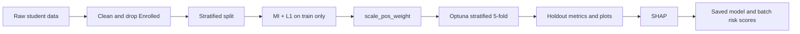

# Student Dropout Prediction

[](https://www.python.org/)
[](https://scikit-learn.org/)
[](https://xgboost.readthedocs.io/)
[](https://optuna.org/)
[](https://shap.readthedocs.io/)
[](LICENSE)
[](https://github.com/aryonmt/student-dropout-prediction)

Binary classifier that estimates whether a student will **drop out** or **graduate**, using academic and administrative records from the Polytechnic Institute of Portalegre. The positive class is Dropout (`1`). The negative class is Graduate (`0`).

This is an end-of-first-year early-warning model. Second-semester curricular features dominate the explanation, so the score is not a day-of-enrollment prediction.

Repository: [https://github.com/aryonmt/student-dropout-prediction](https://github.com/aryonmt/student-dropout-prediction)

Author: aryo ([https://github.com/aryonmt](https://github.com/aryonmt)). Released under the MIT license; see [LICENSE](LICENSE).

## Business problem

Institutions need a ranked list of students who are more likely to leave before graduation, early enough that advising and financial support can still change the outcome of the year. The decision this model supports is binary: flag a student as Dropout or Graduate after first-year curricular results are known.

Students still enrolled are outside the training target. The model does not estimate time-to-dropout, and it does not assign a score on the day of enrollment.

## Dataset and features

Source data is the UCI dataset [Predict Students' Dropout and Academic Success](https://archive.ics.uci.edu/dataset/697/predict+students+dropout+and+academic+success) (Realinho et al.): 4,424 students from the Polytechnic Institute of Portalegre, labeled Dropout, Enrolled, or Graduate. The file is semicolon-separated.

The pipeline drops Enrolled and keeps **3,630** rows (about **60.9%** Graduate, **39.1%** Dropout) and **36** numeric predictors. After that filter there are zero missing values.

The UCI extract is not stored in git. Place it at `data/data.csv` before training.

| Group | Columns |
| --- | --- |
| Demographics and application | Marital status, application mode, application order, course, daytime/evening attendance, previous qualification, nationality, admission grade, age at enrollment, gender, international, displaced, special educational needs |
| Socioeconomic and financial | Mother's and father's qualification and occupation, debtor, tuition fees up to date, scholarship holder |
| First-semester curricular units | Credited, enrolled, evaluations, approved, grade, without evaluations |
| Second-semester curricular units | Credited, enrolled, evaluations, approved, grade, without evaluations |
| Macroeconomics | Unemployment rate, inflation rate, GDP |
| Target | Dropout (`1`) or Graduate (`0`) after Enrolled rows are removed |

Class imbalance is handled inside XGBoost with `scale_pos_weight = n_graduate / n_dropout` on the training fold. There is no SMOTE step, and imbalanced-learn is not a dependency.

## Pipeline



1. Load `data/data.csv`, drop Enrolled, and keep the 3,630 Graduate/Dropout rows.
2. Stratified 80/20 split (`test_size=0.20`, `RANDOM_STATE=42`). The holdout has **726** students.
3. Feature selection on the training split only: the union of the top 12 mutual-information features and an L1 logistic regression (`liblinear`, `C=0.01`). Selected names are sorted so column order stays stable.
4. Fit an Optuna-tuned `XGBClassifier`. The objective maximizes mean ROC-AUC on stratified 5-fold cross-validation. `python main.py` runs **20** trials. `scale_pos_weight` is set from the training-fold class counts.
5. Score the holdout, write plots under `reports/`, and explain the test matrix with SHAP.
6. Save `models/dropout_xgb.joblib` and `models/selected_features.json` for batch scoring.

Logistic regression is the L1 screen inside feature selection. It is not a reported benchmark model.

## Benchmarking

Holdout figures below are read from the checked-in artifacts `reports/confusion_matrix.png` and `reports/roc_curve.png`. Rows of the confusion matrix are the true class and columns are the predicted class, in the order Graduate, Dropout.

|  | Predicted Graduate | Predicted Dropout |
| --- | ---: | ---: |
| True Graduate | 411 | 31 |
| True Dropout | 28 | 256 |

| Model | Accuracy | Balanced accuracy | Dropout precision | Dropout recall | Dropout F1 | Macro F1 | ROC-AUC |
| --- | ---: | ---: | ---: | ---: | ---: | ---: | ---: |
| XGBoost | 0.9187 | 0.9156 | 0.8920 | 0.9014 | 0.8967 | 0.9149 | 0.9699 |

Dropout precision is 256/287 = 0.8920. Dropout recall is 256/284 = 0.9014. Dropout F1 is **0.8967**. Macro F1 is **0.9149**. These are different quantities. ROC-AUC **0.9699** is the value printed on the ROC figure.

Graduate class on the same holdout: precision 0.9362, recall 0.9299, F1 0.9330.

Random forest, LightGBM, CatBoost, and neural nets are not trained in this repository, so they have no scores.

## Explainability

`reports/shap_summary.png` is a SHAP `TreeExplainer` summary on the test matrix, ordered by mean absolute SHAP value. A positive SHAP value increases predicted dropout probability. These associations are not causal effects.

1. **Curricular units 2nd sem (approved)** — more approvals push SHAP down (lower dropout probability).
2. **Curricular units 1st sem (approved)** — same direction.
3. **Tuition fees up to date** — fees that are not up to date raise dropout probability.
4. **Curricular units 2nd sem (grade)**
5. **Curricular units 2nd sem (enrolled)**
6. **Scholarship holder** — holding a scholarship lowers dropout probability.
7. **Course**
8. **Admission grade**
9. **Curricular units 2nd sem (evaluations)**
10. **Age at enrollment** — older students have a small push toward dropout.

Because second-semester curricular features lead the ranking, the model is an end-of-first-year warning, not a score available on the day a student enrolls.

## Quickstart

Requires Python 3.12. The UCI CSV is local only.

```bash
git clone https://github.com/aryonmt/student-dropout-prediction.git
cd student-dropout-prediction
```

Windows PowerShell:

```powershell
python -m venv .venv
.\.venv\Scripts\Activate.ps1
pip install -r requirements.txt
```

macOS / Linux:

```bash
python3 -m venv .venv
source .venv/bin/activate
pip install -r requirements.txt
```

Place the UCI extract at `data/data.csv`, then train. Cross-validation is the Optuna stratified 5-fold search inside `python main.py`. There is no separate CV script.

```bash
python main.py
python -m src.predict --input path/to/students.csv --output reports/risk_scores.csv
```

`src.predict` requires `models/dropout_xgb.joblib` and `models/selected_features.json`, both written by `main.py` and gitignored. The input CSV uses the same columns as the UCI extract. Semicolon is the canonical separator; comma is accepted. The scored file is comma-separated and adds `dropout_probability` and `predicted_status` (`Dropout` if probability ≥ 0.5, otherwise `Graduate`).

## Repository layout

```text
student-dropout-prediction/
├── data/data.csv                 # local only, gitignored
├── notebooks/01_EDA.ipynb
├── reports/                      # confusion_matrix.png, learning_curve.png, roc_curve.png, shap_summary.png
├── models/                       # created by main.py, gitignored
├── src/                          # __init__.py, config.py, data_loader.py, features.py, train.py, evaluate.py, predict.py
├── main.py
├── requirements.txt
├── LICENSE
├── .gitignore
└── README.md
```

## Reproducibility and limitations

`RANDOM_STATE = 42` in `src/config.py` covers the split, mutual information, L1 logistic regression, XGBoost, stratified cross-validation, and the Optuna TPE sampler. Selected feature names are sorted before they are saved. The PNG files in `reports/` were produced before the sampler was seeded, so a fresh run is deterministic but is not guaranteed to match those PNGs exactly.

The L1 logistic regression screen is fit without standardization, so the penalty does not treat predictors on different scales equally.

Enrolled students are excluded, so the reported rates describe only the Graduate-versus-Dropout subset. SHAP values describe associations in the fitted model; they are not evidence that the model learned causal patterns. Saved models and `data/data.csv` are gitignored and must be produced locally.

## Citation

Realinho, V., Vieira Martins, M., Machado, J., & Baptista, L. (2021). Predict Students' Dropout and Academic Success [Dataset]. UCI Machine Learning Repository. https://doi.org/10.24432/C5MC89

Realinho, V., Machado, J., Baptista, L., & Martins, M. V. (2022). Predicting Student Dropout and Academic Success. *Data*, 7(11), 146. https://doi.org/10.3390/data7110146

UCI dataset page: https://archive.ics.uci.edu/dataset/697/predict+students+dropout+and+academic+success
